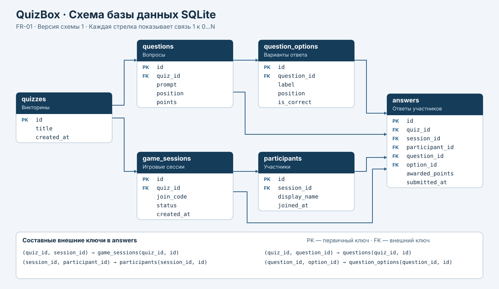

# FR-01. Схема базы данных SQLite и миграции



## Что хранится в базе

| Таблица | Назначение |
| --- | --- |
| `quizzes` | Наборы вопросов, которые организатор может запускать несколько раз. |
| `questions` | Вопросы викторины, их порядок и количество баллов за верный ответ. |
| `question_options` | Варианты ответа, их порядок и признак правильного варианта. |
| `game_sessions` | Отдельные запуски викторины с кодом входа и статусом. |
| `participants` | Участники конкретного запуска. |
| `answers` | Выбранный вариант, начисленные баллы и время ответа. |

Составные внешние ключи гарантируют, что участник отвечает в своей сессии на вопрос из её викторины и выбирает вариант этого вопроса. Уникальное ограничение разрешает один ответ участника на вопрос в каждой сессии. Для вопроса допускается не более одного правильного варианта. Пустой черновик можно сохранить.

## Допущения для ревью

- Для викторины выбрана модель с одним вариантом ответа. Перед её началом сервер проверяет, что в викторине есть вопросы и у каждого вопроса есть минимум два варианта и один правильный ответ. На уровне БД вопрос также может существовать без правильного варианта, что оставляет возможность хранить вопросы опроса.
- Коды входа уникальны среди всех сессий. Сервер генерирует коды и проверяет, что по введённому коду открыт вход в игру. Допустимые статусы сессии — `waiting`, `active` и `finished`.
- Сервер проверяет, что вопрос открыт для ответа, и вычисляет `awarded_points` на основании правильного варианта и стоимости вопроса. Сохранённые баллы суммируются по участнику и сессии. Сервер блокирует изменение использованных вопросов и вариантов после создания сессии, чтобы их формулировки и правильные ответы сохранились для истории.
- SQLite блокирует удаление викторины при наличии сессий и удаление сущностей, на которые ссылаются сохранённые ответы. Политика удаления сыгранных сессий и порядок перехода между вопросами остаются на уровне сервера.
- Для локальных дат используется UTC. При каждом подключении сервера к базе нужно выполнять `PRAGMA foreign_keys = ON` до начала транзакции.
- Схема сверена с приложенным отчётом «Требования и техническое задание», разделы 1.3 и 1.5. В них описаны квизы и опросы в локальной сети без интернета. Требования к структуре таблиц, кодам входа и подсчёту баллов отчёт не задаёт. Эти решения относятся к проектированию FR-01.

## Применение миграции

Нужен Python 3 со встроенным SQLite версии 3.37 или новее, поскольку таблицы используют режим `STRICT`. Проверить версию и применить схему можно из каталога `quizbox-mvp`:

```powershell
python -c "import sqlite3; print(sqlite3.sqlite_version)"
python backend/migrate.py
```

По умолчанию скрипт создаёт `backend/quizbox.sqlite3`. Для ревью можно использовать отдельный файл:

```powershell
python backend/migrate.py --database .\review.sqlite3
python backend/migrate.py --database .\review.sqlite3
```

Оба вызова выведут версию `1`. Повторный запуск оставляет уже применённую схему и данные без изменений. Версия хранится в `PRAGMA user_version`. Все ожидающие миграции применяются в одной транзакции. При ошибке изменения схемы и её версии откатываются. База с неизвестной версией или существующей схемой без версии отклоняется.

Для следующего изменения добавьте новый файл, например `backend/migrations/002_add_indexes.sql`. Скрипт применяет файлы по порядку. Управление транзакцией и версией выполняет Python-скрипт. Уже применённые SQL-файлы остаются в истории без правок.

## Проверка

Из каталога `quizbox-mvp` выполните `python -m unittest discover -s tests -v`. Тесты проверяют повторный запуск, откат неудачной миграции и целостность ответов. Для каждого теста создаётся временная база.
